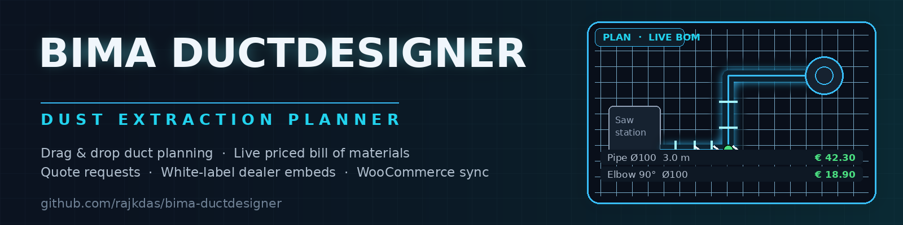

# 💨 BIMA DuctDesigner — Dust Extraction Planner

**DEMO : https://duct-designer-drag-drop.vercel.app/?app=builder**



[](https://github.com/rajkdas/bima-ductdesigner/actions/workflows/ci.yml)


A browser-based **dust-extraction planner for woodworking shops**. Drag pipes and
fittings onto a scaled floor plan, get a **live-priced bill of materials** straight
from the product catalogue, send **quote requests**, and share any design with a
**short link**. Machine dealers run the whole planner **white-label on their own
sites** for a monthly licence — one Next.js app, one SQLite database, zero
infrastructure to operate.

> 🏭 **Zero-config persistence** — the database bootstraps itself on the first
> request: tables are created and 71 demo products, demo dealers and a complete
> 18 × 12 m sample layout (`/?design=demo`) are seeded automatically. No migration
> step, no seed script to run.

## Features

- **Plan on a scaled SVG canvas** — 0.25 m grid, pan/zoom (wheel + pinch),
  drag-from-palette placement, rotation handles, and keyboard shortcuts
  (`R` rotate, `D` duplicate, `Del` delete, `Esc` deselect).
- **Port snapping that prevents nonsense ducts** — parts connect only to matching
  ports; a green highlight shows flow-aligned joins, so every run stays buildable.
- **Live priced BOM** — placed parts are aggregated by SKU and priced from the
  catalogue with net / VAT / gross totals; one-click PDF export (jsPDF, client-side).
- **Isometric 3D check** — a lightweight projected preview including installation
  heights and flex drops. No WebGL, fast on any shop-floor device.
- **Designs & share links** — anonymous save returns a short share ID; the
  read-only share view (`/?design=<shareId>`) re-prices the BOM at open time with
  current catalogue data, so quotes never go stale.
- **Quote requests** — customers submit contact data plus the design reference;
  the admin panel runs the full pipeline (new → in touch → offered → won / lost).
- **White-label dealer embeds** — admin-managed licences (monthly fee, brand
  colour, status), embeddable via the `/embed.js` loader or a plain iframe, with
  optional sub-domain routing (`planner.dealer-domain.com`).
- **WooCommerce sync** — one click in the admin panel imports products by SKU from
  the WooCommerce REST API; prices stay live in the shop, geometry (Ø, length,
  angle) comes from product attributes.
- **Admin panel** — dashboard with MRR and open quotes, dealer licences, inline
  product price editing, quote workflow, and shop settings (VAT, currency, branding).
- **Operator documentation built in** — `/?docs=1` ships a manual your dealers can
  read without leaving the app.

## Views & URLs

Single-page app — every view runs on `/` and is selected by URL parameter:

| View | URL |
| --- | --- |
| Landing page | `/` |
| Planner | `/?app=builder` |
| Shared design (read-only, live prices) | `/?design=<shareId>` · demo: `/?design=demo` |
| Dealer embed (chrome-less, branded) | `/?embed=1&dealer=<slug>` |
| Admin panel | `/?admin=1` |
| Operator documentation | `/?docs=1` |
| Embed loader script | `/embed.js` |

## The planner workflow

```
PLANNER (/?app=builder)               LIVE COMMERCE
┌─────────────────────────────┐     ┌───────────────────────────────┐
│ drag pipes & fittings       ├─────┤ products table (WooCommerce   │
│ port snapping · 0.25 m grid │     │ sync: price · Ø · L · angle)  │
│ rotate · duplicate · delete │     └───────────────┬───────────────┘
└──────────────┬──────────────┘                     │
               ▼                                    ▼
┌─────────────────────────────┐     ┌───────────────────────────────┐
│ BOM rollup by SKU           ├─────┤ net / VAT / gross totals      │
└──────────────┬──────────────┘     └───────────────────────────────┘
               ▼
   save → /?design=<shareId>   read-only share view, re-priced on open
   quote → /api/quotes         admin pipeline (/?admin=1)
   embed → /?embed=1&dealer=x  white-label iframe on the dealer site
```

## Requirements

- **Node.js ≥ 20.9** (20 LTS and 22 tested; Vercel builds on 22)
- **npm 10+**
- ~500 MB disk for `node_modules`; 512 MB RAM is enough
- Any modern browser (SVG + CSS 3D transforms only, no WebGL required)

## Installation

1. Clone and install (the `postinstall` hook runs `prisma generate` automatically):

   ```bash
   git clone https://github.com/rajkdas/bima-ductdesigner.git
   cd bima-ductdesigner
   npm install
   ```

2. Create your env file (`Copy-Item .env.example .env` on Windows PowerShell):

   ```bash
   cp .env.example .env
   ```

3. Optional — sync the local SQLite schema (the first API call bootstraps it
   anyway; this just pre-creates the file):

   ```bash
   npm run db:push
   ```

## Quick start

```bash
npm run dev          # http://localhost:3000
```

Open **`/?app=builder`**, drag a pipe from the palette onto the plan, snap it to a
machine port (green = flow-aligned), add elbows and a flex drop, and watch the BOM
update live. Hit **Save** to get a share link, or open **`/?admin=1`** to manage
products, dealers and quotes.

## Configuration

| Setting | Type | Default | Description |
| --- | --- | --- | --- |
| `DATABASE_URL` | env var | `file:/tmp/ductdesigner.db` on Vercel | SQLite file location. Point it at a Turso URL (`libsql://…`) for permanent hosting. |
| `ADMIN_PASSWORD` | env var | `admin123` | Password for `/?admin=1`. **Change it before sharing the demo link publicly.** |
| `ADMIN_SECRET` | env var | — | Long random string used to sign the admin session cookie. |
| `WOO_STORE_URL` | env var | unset | WooCommerce base URL, enables the product sync. |
| `WOO_CONSUMER_KEY` / `WOO_CONSUMER_SECRET` | env vars | unset | WooCommerce REST keys (read access). |
| `ROOT_DOMAIN` | env var | unset | Enables dealer sub-domains; needs wildcard DNS `*.your-domain.com`. |

## Tech stack

| Layer | Choice | Why |
| --- | --- | --- |
| Shell | **Next.js 16** (App Router, single route) | One deployable; views switch via URL params; serverless-friendly |
| Language | **TypeScript 5**, strict | Geometry + money math need types |
| Plan canvas | **SVG** (no WebGL) | Crisp at any zoom, runs on every device |
| State | **Zustand** | Small plan + BOM store without boilerplate |
| Database | **Prisma 6 + SQLite** | Zero-config, runtime bootstrap, Turso-compatible |
| Prices | **WooCommerce REST v3** | Catalogue stays in the shop — no double bookkeeping |
| PDF | **jsPDF** (client-side) | BOM / quote export without a server render step |
| Styling | **Tailwind CSS 4 + shadcn/ui** | White-label theming via CSS variables |
| Embeds | **`public/embed.js` + iframe** | One `<script>` tag on any dealer site |

## Architecture

```
src/
├── app/                    # single-route shell + REST API
│   ├── api/                #   products · designs · quotes · dealers · admin · settings
│   ├── layout.tsx          #   metadata, fonts, favicon (icon.svg / favicon.ico)
│   └── page.tsx            #   view switcher (?app / ?design / ?embed / ?admin / ?docs)
├── components/
│   ├── builder/            # PlanCanvas, palette, BOM panel, dialogs, IsoView
│   ├── admin/              # dashboard, dealers, products, quotes, settings
│   ├── share/              # read-only share view
│   ├── landing/            # marketing page
│   └── docs/               # operator documentation (/?docs=1)
├── lib/                    # geometry engine, plan store, BOM rollup,
│                           # runtime schema bootstrap + demo seed, woo sync, pdf
└── middleware.ts           # dealer sub-domain routing (ROOT_DOMAIN)
prisma/schema.prisma        # Product, Dealer, Design, QuoteRequest, Settings
public/embed.js             # one-tag embed loader for dealer sites
scripts/reseed-demo.ts      # rebuild the demo design after seed changes
docs/DEPLOY-VERCEL.md       # step-by-step Vercel deployment + troubleshooting
```

## API endpoints

| Endpoint | Method | Purpose |
| --- | --- | --- |
| `/api/products` | GET | Catalogue for palette + BOM pricing |
| `/api/products/sync` | POST | Pull products from WooCommerce (admin) |
| `/api/designs` | POST | Save a design, returns `shareId` |
| `/api/designs/[shareId]` | GET / PUT | Load or update a shared design |
| `/api/quotes` | POST | Submit a quote request (share view) |
| `/api/quotes/[id]` | PATCH | Update quote status (admin) |
| `/api/dealers` | GET / POST / PATCH | Dealer licences (`?slug=` public lookup for embeds) |
| `/api/admin/session` | POST | Admin login (`ADMIN_PASSWORD`) |
| `/api/admin/stats` | GET | Dashboard metrics |
| `/api/settings` | GET / PUT | Shop settings (VAT, currency, branding) |

## Deploy to Vercel (free)

1. Push this folder to a GitHub repo and import it on [vercel.com](https://vercel.com/new) —
   Next.js settings are detected automatically.
2. Add two environment variables: `ADMIN_PASSWORD` and `ADMIN_SECRET`.
3. Deploy. The first page/API call creates the tables and seeds the demo data —
   no database setup, no build-time DB access.

Full walkthrough with CLI alternative, testing checklist and troubleshooting:
**[docs/DEPLOY-VERCEL.md](docs/DEPLOY-VERCEL.md)**.

> Free-tier notes: serverless functions cannot keep files permanently — the demo
> database in `/tmp` resets after idling or a new deployment (saved designs,
> price edits and quote requests are lost; the built-in demo data always comes
> back). For permanent storage point `DATABASE_URL` at a free
> [Turso](https://turso.tech) database — the schema bootstrap handles it unchanged.

## FAQ / Troubleshooting

**Catalogue empty on a fresh deployment?**
The first request bootstraps the schema and seeds 71 products — give it a few
seconds, then reload. If it stays empty, check the Vercel function logs for a
Prisma error.

**Saved designs or quotes disappear after a while?**
Demo mode: the `/tmp` database is ephemeral on serverless. Data resets on idle
wake-up or redeploy. Use a `DATABASE_URL` (e.g. Turso) for persistence.

**Admin login rejects my password?**
The fallback is `admin123`. If you set `ADMIN_PASSWORD` in the Vercel dashboard,
wait for the redeploy to finish — env vars apply per deployment.

**WooCommerce sync returns no products?**
The consumer key/secret need read access, the store URL must start with
`https://`, and products are matched by SKU — SKUs must exist on both sides.

**Port 3000 already in use?**
Run `npx next dev -p 3001`.

**Dealer embed shows a blank box on WordPress?**
Some security plugins strip third-party scripts. Load `/embed.js` from the same
protocol (https), or fall back to the plain iframe snippet from `/?docs=1`.

## Changelog

See [CHANGELOG.md](CHANGELOG.md).

## Contributing

See [CONTRIBUTING.md](CONTRIBUTING.md) — CI runs lint + type-check + build on
Node 20 and 22 for every push and pull request.

## License

[MIT](LICENSE) © 2026 rajkdas. Next.js, React, Prisma, Vercel, WordPress and
WooCommerce are trademarks of their respective owners — this project is not
affiliated with or endorsed by them.

---

Built and maintained by **Raj Kumar Das**. Bug reports and pull requests are
welcome at <https://github.com/rajkdas/bima-ductdesigner/issues>.
